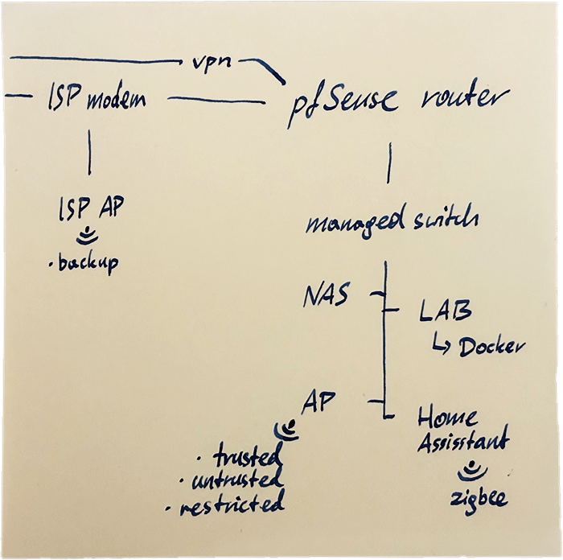

In the past month we've had weekly high severity security vulnerabilities, notably in PHP, Synology, MCTCP. 

I don't think we're going to catch a break with AI that tirelessly pores over every nook and cranny of the world's source code. With each device being a potential trojan horse on your home network, one thing that brings me peace is how the network is segmented and isolated.

## Network segmentation

The router sets up VLANs which compartmentalize the network into:

- **Trusted VLAN**: Unrestricted WAN internet access and full routing access to all other VLANs.
  - This is the default everyone gets with their ISP router.
- **Untrusted VLAN**: Outbound WAN internet access only; blocked from accessing other VLANs.
  - All IOT gadgets go here.
- **Restricted VLAN**: No access to internet or any other part of network.
  - Primarily for the TV, which only receives HDMI signal and does not need any connectivity.
  - Also good candidate for cameras, so that their feed stays local. Get an ONVIF camera.

## Networking infrastructure

This is possible thanks to a few devices at the trunk of the network that have capability to work with tagged packets.

- **Router**: Defines VLANs and firewall
  - Defines VLANs
  - Firewall constrains traffic from and across VLANs
  - DHCP, DNS
  - Proxy
  - Avahi and other workarounds against complexity of segmentation

- **Access Point**
  - Broadcasts SSIDs corresponding to all VLANs
  - Sets VLAN tags based on SSID.

- **Managed switch**: 
  - Sets VLAN tags based on physical port or MAC address

### Simple diagram

In addition to the Router, Access Point (AP) and managed switch,
this diagram shows:
- Network Attached Storage
- Home Assistant and its Zigbee network of local IOT devices that don't require cloud connectivity
- Home Lab that runs various services in Docker
- the ISP modem (WAN) and its Access Point which broadcasts backup SSID in case of a hypothetical issue with my network

## Caveats

You can find full solutions online, so I'll just list special stuff I had to do.

1. Network discovery does not work across VLANs.
  - To work around it, use Avahi on the router. It's a mDNS reflector and allows devices to discover over the network
  - Set firewall to allow mDNS and device-specific traffic out of the untrusted VLAN.
2. Printer discovery did not work.
  - The printer needs to *just work*, so it's promoted to trusted VLAN so that personal devices can use it and all its features.
  - Get a trusted, reliable workhorse, like Brother, so that this convenience does not feel like a compromise in security.
3. Use proxy server to give docker services a friendly name.
  - After a few docker containers running on the home lab, I could no longer remember the port numbers.
  - DNS Resolver maps human-readable name to IP address of the docker host
  - HAProxy maps human-readable name to IP address and a port
4. Use custom DNS server!
  - Your ISP has less data on you to sell to advertisers.
  - ISP dns is so slow
  - Can configure DNS over TLS or HTTPS
  - Some options to consider
    - Quad9: `9.9.9.9` - security, privacy
    - CloudFlare: `1.1.1.1` - low latency
    - ControlD: `76.76.2.5` - ad blocking
    - OpenDNS: `208.67.222.222` - filtering
